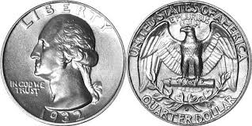

# Two Games

This project is a small webpage containing two simple games: a **coin
toss game** and a *number guessing game*.

## How to Play

-   Choose Heads or Tails in the coin toss game.
-   Guess a number between 1 and 100 in the guessing game.
-   Try to guess the number in 10 turns or fewer.

The guessing game uses JavaScript to generate a random number:

``` javascript
let randomNumber = Math.floor(Math.random() * 100) + 1;
```

Learn more about
[JavaScript](https://developer.mozilla.org/en-US/docs/Web/JavaScript).


